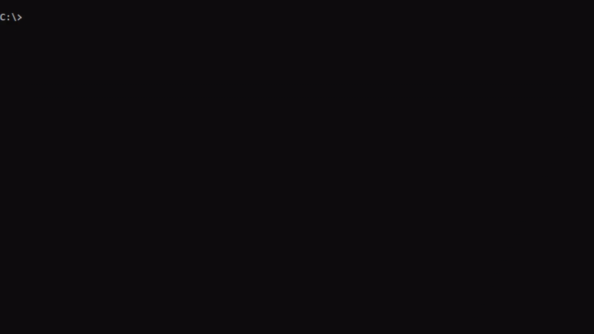

# tosk 🚀
A very lightweight, easy-to-use CLI task / todo list app written in Rust, inspired by [todo](https://github.com/sioodmy/todo)

<p align="center">
   
</p>

## Installation
### Install with Cargo
You can easily install **tosk** with Cargo. Make sure you have it installed and Rust too. 
```bash
cargo install tosk
```

### Install with Nix
Add `tosk` to the inputs of your `flake.nix`:
```nix
inputs = {
    tosk.url = "github:sharkmu/tosk";
};
```

Then add the package to your system packages:
```nix
environment.systemPackages = [
    inputs.tosk.packages.${pkgs.stdenv.hostPlatform.system}.default
];
```

### Build from Source
1. Clone the repository:
   ```bash
   git clone https://github.com/sharkmu/tosk.git
   cd tosk
   ```
2. Build and run with Cargo:
   ```bash
   cargo run
   ```

## Usage

| Action | Command |
| :--- | :--- |
| Add a new task | `tosk add <task>` |
| Remove / complete a task | `tosk rm <index>` |
| Remove / complete all tasks | `tosk rm --all` |
| List all tasks | `tosk list` (or `tosk ls`) |
| View details for a specific task | `tosk info <index>` |
| Edit an existing task | `tosk edit <index>` |
| Reorder a task | `tosk reorder <old index> <new index>` |
| Show the help message | `tosk help` |

## Configuration

Currently, `tosk` supports a single configuration option (`archive_enabled`) to toggle the archive feature. You can modify it in your platform's configuration directory:

* **Linux:** `$XDG_CONFIG_HOME/tosk` (defaults to `~/.config/tosk` when `XDG_CONFIG_HOME` is unset or not an absolute path)
* **macOS:** `~/Library/Application Support/tosk`
* **Windows:** `%APPDATA%\tosk` (typically `C:\Users\<username>\AppData\Roaming\tosk`)

## Contributing

Feel free to contribute to the project. Be aware that this is a beginner project, so the code may sometimes be a bit harder to read.

You can contribute by:
* Opening an issue to report bugs or share feedback
* Submitting a pull request (even small improvements to this `README.md` help!)

## Name Origin

The project name (**tosk**) is a mixture of **to**do and ta**sk**
